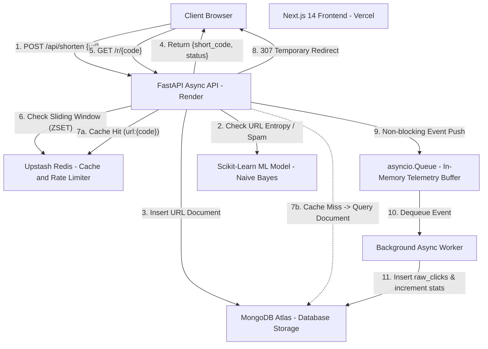

# ShortX ⚡ — High-Performance URL Shortener & Analytics Platform

[](https://nextjs.org/)
[](https://fastapi.tiangolo.com/)
[](https://www.mongodb.com/)
[](https://upstash.com/)
[](https://www.python.org/)
[](https://shortx-url-shortener.vercel.app)
[](https://shortx-url-shortener-8oz8.onrender.com/health)

A production-deployed, full-stack URL shortening service engineered with a **Cache-Aside architecture**, non-blocking asynchronous analytics micro-batching, sliding-window rate limiting, and an ML-based spam classification stub.

Designed to maximize throughput and minimize latency on modern cloud infrastructure while maintaining fault-tolerant database fallbacks.

---

## 🔗 Live Deployments & Repository

| Service | Target URL | Description |
|---|---|---|
| **Production Frontend** | [https://shortx-url-shortener-1w5piewh6-shubh201203s-projects.vercel.app](https://shortx-url-shortener-1w5piewh6-shubh201203s-projects.vercel.app/) | Next.js 14 Web Application |
| **Global Analytics Dashboard** | [https://shortx-url-shortener-1w5piewh6-shubh201203s-projects.vercel.app/dashboard](https://shortx-url-shortener-1w5piewh6-shubh201203s-projects.vercel.app/dashboard) | 7-day activity chart & top links |
| **Backend REST API** | [https://shortx-url-shortener-8oz8.onrender.com](https://shortx-url-shortener-8oz8.onrender.com) | FastAPI on Render |
| **Health Check Endpoint** | [https://shortx-url-shortener-8oz8.onrender.com/health](https://shortx-url-shortener-8oz8.onrender.com/health) | Uptime status probe |
| **GitHub Repository** | [https://github.com/shubh201203/shortx-url-shortener](https://github.com/shubh201203/shortx-url-shortener) | Source code & configuration |

---

## 📌 Problem Statement & Architecture Goals

High-volume URL shorteners handle read-heavy workloads where redirect latency directly impacts user experience. Traditional monolithic designs suffer from:
1. **Redirection Bottlenecks:** Querying primary databases on every redirect request adds unnecessary latency.
2. **Analytics Contention:** Synchronously logging click telemetry (IP, user agent, timestamp) blocks the HTTP response cycle.
3. **Traffic Spikes & Abuse:** Unmitigated bot traffic degrades database performance without fine-grained request throttling.
4. **Third-Party Dependency Fragility:** Hard dependencies on remote caches can take down the entire service if connection timeouts occur.

**ShortX solves these architectural challenges through:**
- **Cache-Aside Pattern with Automatic TTL:** Reads directly from Upstash Redis (`url:{code}`) for sub-50ms cache hits; updates cache dynamically on cache misses.
- **Fail-Open Fault Tolerance:** If Redis is temporarily unreachable, requests fall back to MongoDB Atlas without returning HTTP 500 errors to end users.
- **Non-blocking In-Memory Queue Worker:** Click events are buffered into an internal `asyncio.Queue` worker that batches writes to MongoDB in the background.
- **Sliding-Window Rate Limiting:** Redis Sorted Sets (ZSET) enforce a 100 requests/minute per-IP sliding threshold.
- **ML Spam Classification:** Scikit-learn pipeline (TF-IDF + Naive Bayes) evaluates URL character patterns at creation time to flag suspicious destinations.

---

## 🏗️ System Architecture & Request Lifecycle



---

## ✨ Key Features

- **High-Throughput URL Shortening:** Generates unique, collision-resistant 7-character alphanumeric identifiers.
- **Resilient Cache-Aside Layer:** 24-hour Redis TTL with non-blocking error handling that gracefully falls back to persistent storage.
- **Interactive Analytics Dashboard:** Real-time metrics overview displaying total clicks, total shortened links, top 5 performing URLs, and a 7-day chronological click trendline powered by Recharts.
- **Lightweight ML Spam Detection:** Pre-trained Multinomial Naive Bayes model loaded during application startup to assess incoming URL string entropy.
- **Sliding-Window Rate Limiting:** Enforces fair usage (100 req/min per IP) via Redis ZSET timestamps, failing open if the cache layer degrades.
- **Cross-Origin Security & Preview Support:** Dynamic, strict origin validation supporting canonical production domains (`vercel.app`), local development hosts, and scoped Vercel deployment preview domains (`*-shubh201203s-projects.vercel.app`).

---

## 🧰 Technology Stack

| Domain | Technology | Purpose |
|---|---|---|
| **Frontend Framework** | Next.js 14 (React 18) | Server-side rendered application using the App Router |
| **Data Visualization** | Recharts (v2.10) | Responsive SVG line chart for 7-day click trend analytics |
| **Icons & UI** | Lucide React | Lightweight icons for stats, links, and system status |
| **Backend Framework** | FastAPI (Python 3.11) | High-performance asynchronous REST API framework |
| **ASGI Web Server** | Uvicorn (v0.24) | Production ASGI server supporting asynchronous I/O |
| **Primary Database** | MongoDB Atlas (Motor v3.4) | Asynchronous driver for document storage and aggregation pipelines |
| **In-Memory Cache** | Upstash Redis (redis-py v5.0) | Low-latency caching, rate limiting, and system metric counters |
| **Machine Learning** | Scikit-learn (v1.5) & Joblib | Character n-gram TF-IDF vectorizer + Multinomial Naive Bayes |
| **Testing** | Pytest & HTTPX (ASGITransport) | Asynchronous unit and integration test suite |
| **Deployment Platforms** | Vercel & Render | Decoupled cloud architecture with continuous deployment from GitHub |

---

## 📁 Repository Structure

```text
URL SHORTENER/
├── backend/
│   ├── .python-version               # Pinned Python version (3.11.11) for Render
│   ├── requirements.txt              # Production Python dependencies
│   ├── app/
│   │   ├── __init__.py
│   │   ├── main.py                   # FastAPI application initialization & CORS config
│   │   ├── api/
│   │   │   ├── __init__.py
│   │   │   └── routes.py             # Route handlers: /shorten, /r/{code}, /analytics
│   │   ├── core/
│   │   │   ├── __init__.py
│   │   │   ├── config.py             # Pydantic Settings & environment variable mapping
│   │   │   ├── database.py           # Motor async MongoDB client & index initialization
│   │   │   ├── logging.py            # Latency logging & async Redis metric counters
│   │   │   ├── rate_limiter.py       # Sliding-window rate limiting via Redis ZSET
│   │   │   └── redis.py              # Asynchronous Redis client instance
│   │   ├── models/
│   │   │   ├── __init__.py
│   │   │   └── schemas.py            # Pydantic request & response validation schemas
│   │   ├── services/
│   │   │   ├── __init__.py
│   │   │   └── url_service.py        # Code generation & ML inference execution
│   │   └── worker/
│   │       ├── __init__.py
│   │       └── analytics.py          # Background asyncio queue worker for raw clicks
│   ├── ml_model/
│   │   ├── train.py                  # Character TF-IDF & Naive Bayes training script
│   │   └── spam_model.pkl            # Serialized Scikit-learn pipeline
│   └── tests/
│       └── test_api.py               # Asynchronous pytest suite using httpx.ASGITransport
├── frontend/
│   ├── package.json                  # Next.js, React, Recharts, and dependencies
│   ├── next.config.mjs               # Next.js configuration
│   └── src/
│       └── app/
│           ├── globals.css           # Design tokens, CSS variables, glassmorphism theme
│           ├── layout.js             # Root HTML layout & font definitions
│           ├── page.js               # Homepage: URL shortening input & result display
│           ├── page.module.css       # Homepage styles
│           └── dashboard/
│               ├── page.js           # Analytics Dashboard: Metrics grid & activity chart
│               └── dashboard.module.css
├── render.yaml                       # Render Infrastructure-as-Code Blueprint
├── .env.example                      # Safe template for local environment variables
├── .gitignore                        # Git exclusions for dependencies, builds, and secrets
└── README.md                         # Project documentation
```

---

## 🔌 API Reference

### 1. Create Shortened URL
- **Endpoint:** `POST /api/shorten`
- **Rate Limit:** 100 requests / minute
- **Request Body:**
  ```json
  {
    "url": "https://www.example.com/very/long/target/path"
  }
  ```
- **Response (`200 OK`):**
  ```json
  {
    "short_code": "kU3T3jz",
    "original_url": "https://www.example.com/very/long/target/path",
    "status": "safe",
    "created_at": "2026-10-18T18:12:09.411416"
  }
  ```

### 2. URL Redirection
- **Endpoint:** `GET /r/{code}`
- **Rate Limit:** 100 requests / minute
- **Behavior:** Checks Redis cache → on miss queries MongoDB Atlas → emits asynchronous analytics event to background queue → returns `307 Temporary Redirect` to the original URL.

### 3. Global Analytics Summary
- **Endpoint:** `GET /api/analytics/summary`
- **Description:** Aggregates total link counts, global click totals, top 5 most-trafficked links, and the last 7 days of daily click volume for chart rendering.
- **Response (`200 OK`):**
  ```json
  {
    "global_clicks": 42,
    "total_links": 8,
    "top_links": [
      {
        "short_code": "kU3T3jz",
        "original_url": "https://news.ycombinator.com/",
        "clicks": 19
      }
    ],
    "chart_data": [
      { "name": "Mon", "fullDate": "2026-10-12", "clicks": 4 },
      { "name": "Tue", "fullDate": "2026-10-13", "clicks": 7 }
    ]
  }
  ```

### 4. Per-Link Analytics
- **Endpoint:** `GET /api/analytics/{code}`
- **Response (`200 OK`):**
  ```json
  {
    "short_code": "kU3T3jz",
    "total_clicks": 19,
    "clicks_per_day": {
      "2026-10-18": 12,
      "2026-10-19": 7
    }
  }
  ```

### 5. System Health Check
- **Endpoint:** `GET /health`
- **Response (`200 OK`):** `{"status": "ok"}`

### 6. Observability Metrics
- **Endpoint:** `GET /api/metrics`
- **Response (`200 OK`):**
  ```json
  {
    "total_redirects": 42,
    "cache_hits": 31,
    "cache_misses": 11,
    "rate_limited": 0
  }
  ```

---

## ⚙️ Environment Variables

Copy the provided template to configure your local environment:
```bash
cp backend/.env.example backend/.env
```

| Variable Name | Required | Context | Description & Example Format |
|---|---|---|---|
| `MONGODB_URL` | Yes | Backend | MongoDB Atlas connection string (`mongodb+srv://<user>:<password>@cluster.mongodb.net`) |
| `DATABASE_NAME` | Yes | Backend | Database name (default: `url_shortener`) |
| `REDIS_URL` | Yes | Backend | Upstash Redis connection URI (`rediss://default:<token>@<host>:6379`) |
| `FRONTEND_URL` | Yes | Backend | Allowed CORS frontend origins (comma-separated for multiple environments) |
| `JWT_SECRET` | Yes | Backend | Secret key for future JWT authentication extensions |
| `NEXT_PUBLIC_API_URL` | Yes | Frontend | Public backend base URL without trailing slash (`https://shortx-url-shortener-8oz8.onrender.com`) |

> **Security Guarantee:** Never commit `.env` files or hardcoded database passwords to source control. Ensure `.env` is listed in `.gitignore`.

---

## 🛠️ Local Development Setup

### Prerequisites
- Python 3.11+
- Node.js 18+ & npm
- Local or cloud instances of MongoDB and Redis

### 1. Backend Setup (PowerShell / Windows)
```powershell
cd backend

# Create and activate virtual environment
python -m venv venv
.\venv\Scripts\activate

# Install dependencies
pip install -r requirements.txt

# Verify / train the ML spam classifier stub
python ml_model/train.py

# Launch the FastAPI development server
python -m uvicorn app.main:app --reload --port 8000
```
Backend will be live at `http://localhost:8000` (Interactive Swagger docs: `http://localhost:8000/docs`).

### 2. Frontend Setup
```powershell
cd frontend

# Install Node dependencies
npm install

# Start development server
npm run dev
```
Frontend will be live at `http://localhost:3000`.

---

## 🧪 Automated Testing & Verification

The backend includes an asynchronous test suite built on `pytest` and `httpx.ASGITransport` covering CORS headers, preflight authorization, invalid origin rejection, payload validation, and health checks:

```powershell
cd backend
python -m pytest tests/test_api.py -v
```

### Verified Test Results:
```text
tests/test_api.py::test_options_cors_canonical_origin PASSED             [ 16%]
tests/test_api.py::test_options_cors_preview_origin PASSED               [ 33%]
tests/test_api.py::test_options_disallowed_origin PASSED                 [ 50%]
tests/test_api.py::test_options_other_project_preview_rejected PASSED    [ 66%]
tests/test_api.py::test_health_check PASSED                              [ 83%]
tests/test_api.py::test_validation_error_invalid_url PASSED              [100%]
======================== 6 passed in 2.23s =========================
```

---

## 🚀 Cloud Deployment Architecture

- **Backend (Render):**
  - Configured via `render.yaml` Infrastructure-as-Code.
  - Python version pinned explicitly to `3.11.11` via `backend/.python-version` to ensure binary wheel compatibility.
  - Build command: `pip install -r requirements.txt && python ml_model/train.py`
  - Start command: `uvicorn app.main:app --host 0.0.0.0 --port $PORT`
- **Frontend (Vercel):**
  - Connected directly to GitHub repository with Root Directory set to `frontend`.
  - Production & Preview environment variable `NEXT_PUBLIC_API_URL` set to `https://shortx-url-shortener-8oz8.onrender.com`.

---

## ⚖️ System Design Trade-offs & Engineering Decisions

1. **In-Memory `asyncio.Queue` vs. External Message Broker (Kafka/RabbitMQ):**
   - *Decision:* Used Python's native `asyncio.Queue` worker for click event offloading.
   - *Rationale:* Eliminates significant cloud infrastructure costs and maintenance overhead while guaranteeing non-blocking redirect execution.
   - *Trade-off:* Telemetry buffered in memory could be lost if the server process restarts abruptly; for enterprise scale, replacing the queue adapter with AWS SQS or Redis Streams is the natural evolution.
2. **Fail-Open Redis Policy:**
   - *Decision:* Wrapped cache reads and rate-limit checks in non-blocking exception handlers.
   - *Rationale:* System availability is prioritized over strict rate-limiting guarantees. A temporary Redis timeout should never cause a 500 error for an end user navigating a short link.
3. **Scoped Regex Origin Matching for Vercel Previews:**
   - *Decision:* Configured `allow_origin_regex` explicitly targeted to `*-shubh201203s-projects.vercel.app`.
   - *Rationale:* Avoids permissive `*` CORS wildcards with credentials while allowing continuous preview validation directly from Vercel branches.

---

## 🔮 Future Roadmap

- [ ] **Custom Alias Support:** Allow users to define custom, vanity short URL strings with uniqueness validation.
- [ ] **User Authentication & Private Dashboards:** Introduce JWT-based user accounts so creators can manage, edit, and delete their own links.
- [ ] **Geographic & Device Analytics:** Enhance background click telemetry to record country-level geolocation (via Cloudflare headers) and device breakdown.
- [ ] **Expanded ML Classification Dataset:** Expand the spam classifier training corpus from synthetic stubs to verified URL phishing threat intelligence feeds.

---

## 📄 License

This project is currently unlicensed. An open-source license (such as MIT) may be added based on repository owner preference.
