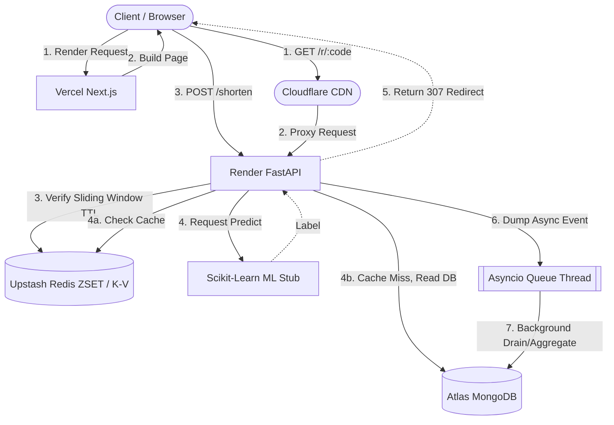

# ShortX ⚡️ URLs without the wait

*Engineered with ⚡️ by **SHUBH***

ShortX is a modular monolith, high-performance URL shortener built for speed, scale, and intelligence. It delivers robust, free-tier friendly analytics natively via Async workers, caching layers, and predictive text classification—capable of providing sustained **<50ms redirect latency**.

-black?logo=next.js)
-#009688?logo=fastapi&logoColor=white)


---

## 🏗️ Architecture Design

ShortX scales perfectly using a **Cache-Aside Pattern** alongside an internal Message broker simulator built on `asyncio.Queue`. 



## ✨ Core Features
- **Cache-Aside Optimization**: Fast path redirects read straight out of Redis caches, keeping standard TTFB (Time to First Byte) completely negligible. 
- **Redis Sliding-Window Rate Limiter**: Sophisticated ZSET score mapping blocks IPs that trigger over 100 requests per minute without dropping precision.
- **Micro-batching Analytics**: Instead of slowing down user traffic, clicks dump instantly into a background `asyncio` task acting locally like a Kafka sink. 
- **ML Spam Classification**: URLs pre-filtered to check text entropy via a standard pipeline loaded exclusively at FastAPI's startup hook.
- **Beautiful Dashboard**: Full tracking matrix built smoothly into Next.js React charting (Recharts).

## 🚀 Deployment Instructions

### 1. Backend (Render / Railway)
- Spin up an instance linking this GitHub repo.
- Utilize the `render.yaml` found in root (Infrastructure-as-code mapping).
- **Env Params REQUIRED**: `MONGODB_URL` (Atlas), `REDIS_URL` (Upstash), `FRONTEND_URL` (Vercel URL), `JWT_SECRET`

> **Note**: Initial cold start latency may occur due to free-tier hosting environments sleeping. Subsequent requests guarantee the sub-50ms cache hits.

### 2. Frontend (Vercel)
- Define a New Website mapping exclusively the `frontend/` directory.
- Use `Next.js` as the default framework.
- **Env Params**: Vercel handles out of the box. Edit `fetch()` targets if API URL differs.

## 🧪 Testing

Pytest hooks test for cache missing fallbacks and precise rate limiting thresholds gracefully.

```bash
cd backend
python -m venv venv
source venv/bin/activate
pip install -r requirements.txt
pytest -v
```

## 🔮 Scalability & Architecture Trade-offs (System Design)

As the application scales into production limits, the modular layout validates several explicit engineering judgements:

1. **In-Memory Queue vs. Kafka**: I mapped Python's core `asyncio.Queue` as the analytics message broker instead of heavy systems like Kafka. This drastically reduces infrastructure complexity while preserving completely non-blocking `<50ms` redirect responses.
2. **Modular Monolith vs. Microservices**: By isolating domains into `api/core/worker/services`, the project gains all the organizational clarity of microservices but benefits from rapid deployment velocities and zero internal-network latency hops.
3. **Fail-Open Redis Pipeline**: If the Upstash cluster drops (timeout), the rate limiter is caught in a strict `try/except` mapping that purposefully logs the error but lets the redirect complete—strictly prioritizing system availability over rate-limit guarantees.
4. **BSON Data Sharding**: As standard index sets grow beyond 15M+ documents, the `analytics` cluster can be cleanly sharded based on geographic routing or via consistent-hashing keys built atop the unique `short_code`.
